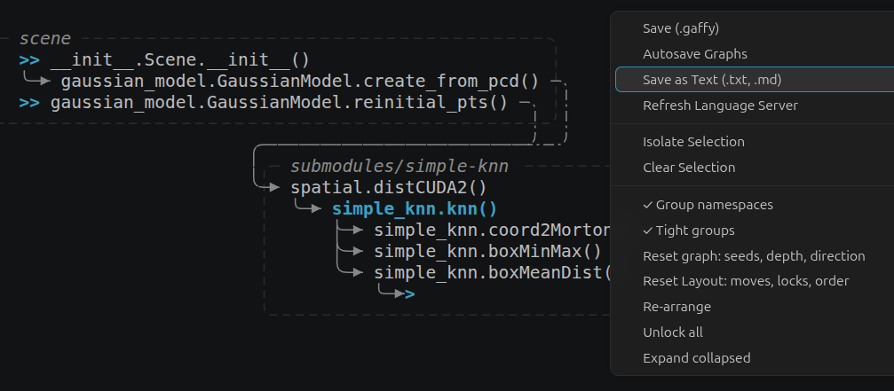

# gaffy
## Call Hierarchy graph.
One of the hammers in my bag to understand code tangles. Persistent data saved to `<vscode-root>/.baggy/`.

Extends vscode `Call Hierarchy` upstream with `downstream` calls in the form of `editable`, `persistent`, `exportable` as ASCII (UTF) graph style.

Supports `Python`, `TypeScript`, `JavaScript`, `Java`, `Rust`, `C`,`C++`, `CUDA`, `C#`, `Go`, `Kotlin`, `Swift`, `Dart`, relying on their language servers. Partial support for `Slang`.  Partial cross language support across `pybind11`, `nanobind`, `wasm-bindgen`. More info in [docs/development.md](docs/development.md#L4). Language Providers: [src/core/langs.ts](src/core/langs.ts#L95)

Generates .json graphs saved as  `<vscode-root>/.baggy/gaffy/<symbol>_<commit>.gaffy`.

### Not published as vscode extension because...
MS appears to think that I am not human, ergo my accounts get locked when i try to publish. Perhaps I need an ai assisstant to pass the "are you human" tests.


## Install from Source

```bash
npm install
npm run package         # typecheck, test, build .vsix
# npm run release       # alternative to `package`, increments version +0.0.1 in pakcage
npm run install:local   # install latest "gaffy-$(node -p 'require('./package.json').version').vsix"
# code --install-extension gaffy-<version>.vsix     #  install <version>

# reenter vscode or reload
`Ctrl+Shift+P` > Developer: Reload Window
```
Scripts descriptions: [docs/development.md](docs/development.md#L50)

### Usage: 1. Code tab > RMB over a symbol >  menu > 

```
gaffy> Call hierarchy (up)  # similar to VS Code Show Call Hierarchy: upstream callers
gaffy> Call hierarchy (dn)  # downstream calls
gaffy> Add to Call graph    # calls and callers in an existing call graph.
```


<p align="center">
   Call Hierarchy (up)" width="32.2%" align="middle">
  &nbsp;<b> -> generates editable vectors </b>&nbsp;
  
  &nbsp;<b> -> exports </b>&nbsp;
</p> 
<small>Example reference on https://github.com/Anttwo/MILo </small>

- Expandable modes: `>>` traverse individual calls, or `switch to -+ mode` a call depth step at once.
- Link types: `───` regular callers, `┈┈` class members,  `·─·─` cross language calls.

```
╭┄ scene ┄┄┄┄┄┄┄┄┄┄┄┄┄┄┄┄┄┄┄┄┄┄┄┄┄┄┄┄┄┄┄┄┄┄┄┄┄┄┄┄┄┄┄┄┄╮
┆  __init__.__init__()                                ┆
┆  └─> gaussian_model.GaussianModel.create_from_pcd() ·┐
┆  >> gaussian_model.GaussianModel.reinitial_pts() ─┐ ┆·
╰┄┄┄┄┄┄┄┄┄┄┄┄┄┄┄┄┄┄┄┄┄┄┄┄┄┄┄┄┄┄┄┄┄┄┄┄┄┄┄┄┄┄┄┄┄┄┄┄┄┄┄│┄╯│
                    ┌─·─·─·─·─·─·─·─·─·─·─·─·─·─·─·─┴─·┘
                    │╭┄ submodules/simple-knn ┄┄┄┄┄┄┄┄┄┄┄┄╮
                    └─> spatial.distCUDA2()               ┆
                     ┆  └─> simple_knn.knn()              ┆
                     ┆      ├─> simple_knn.coord2Morton() ┆
                     ┆      ├─> simple_knn.boxMinMax()    ┆
                     ┆      └─> simple_knn.boxMeanDist()  ┆
                     ┆          └─>>                      ┆
                     ╰┄┄┄┄┄┄┄┄┄┄┄┄┄┄┄┄┄┄┄┄┄┄┄┄┄┄┄┄┄┄┄┄┄┄┄┄╯
```
Most interactions are intuitive albeit some may be arcanely named.

Saving a `.gaffy`, exporting to UTF, `.txt`, `.md`, or debug trace creates `<vscode root>/.baggy/`. 

Default .gaffy vscode config declared in `package.json`, is accessble accessible thru the gaffy window `Options` menu. 

Functions can be grouped by namespace or as flat hierarchy and reorganized in the gaffy canvas. Calls hierarchies stemmig to the queried function `seed` can be expanded or collapsed. A graph can have multiple seeds. When adding a new seed, the call links between seeds are exposed. 


### Usage 2. vs Code Explorer menu


Development: `gaffy/` in VS Code, F5 (Extension Development Host); `npm run watch` rebuilds on change.

## Docs

- [docs/development.md](docs/development.md): tooling, release, publishing, project parts, security measures.
- [docs/heuristics.md](docs/heuristics.md): layout rules with code links, as a pipeline graph; [docs/heuristics.gaffy](docs/heuristics.gaffy): the same graph as a gaffy view.
- [docs/ordering.md](docs/ordering.md): functions that change what a view shows and where (triggers, interpreters, layout), drawing of one call, what a drag moves.


## Usage 3. script call graphs

```python
import json, pathlib, subprocess

# Seed syntax
# path/to/file.ext#Class.method  # must be a valid code symbol
# path/to/file.ext#function
# path/to/file.ext:line_number

view = {"gaffy": 1, "name": "batch", "view": {
    "seeds": ["src/pkg/mod.py#Scoobie.do"], # one or more valid seeds
    "arrange": "auto", # | grow  # expansion mode
    "direction": "both",
    "depthUp": 2,   # layers of callers
    "depthDown": 3, # layers of called 
    "save": True}}
p = pathlib.Path(".baggy/gaffy/batch.gaffy")
p.parent.mkdir(parents=True, exist_ok=True)
p.write_text(json.dumps(view))
subprocess.run(["code", str(p)])
```


## Files

```
.baggy/                        shared with other tools in my bag of hallenrs
  gaffy/
    <symbol>_<commit>.gaffy    JSON file if saved   # saved views are open frozen
    <symbol>_<commit>.md       saved on export markdown
    <symbol>_<commit>.txt      saved on exported text
    cache/calls.json           cached language-server answers
    trace/<view>.jsonl         gaffy.trace log
    style.json                 appearance: font, colors, labels, frames, call lines (Options set the rest per view)
```

Placement: views created in VS Code under the workspace folder; views written by giddy or a script under their repository (seed paths, exports and the commit hash refer to the folder holding `.baggy/`). Style and call cache: per workspace folder. Views in a `.gaffy/views/` folder still open; new files go to `.baggy/gaffy/`.

## Layout debugging

Options > Arrange > Layout debug (setting `gaffy.debugLayout`). Right click a function or group > **Why Here?**: the decisions that placed it. The panel under the graph:
- **Rules**: every layout rule with its switch, choice and parameters, saved with the graph; links to [docs/heuristics.md](docs/heuristics.md) and the code. Terms: [docs/terms.md](docs/terms.md).
- **Actions**: each change, what moved where, the rule that moved it.
- **Calls**: how each call line is drawn (branch, trunk, path search), search order, crossings, cost.

Offline, in this repository:

```bash
npm run explain -- <view.gaffy>                        # every decision, with file:line
npm run explain -- <view.gaffy> --unit <text> --flags  # one unit's decisions, flagged only
npm run explain -- <view.gaffy> --off h20_unmoved_box_descent,h23_settle   # what moves without these rules
npm run explain -- <view.gaffy> --trace .baggy/gaffy/trace/<view>.jsonl    # replay a gaffy.trace
npm run metrics -- <view.gaffy> '{"alt":{"h25_routing_order":"longest"}}'  # crossings, bends, time per rule choice
```
