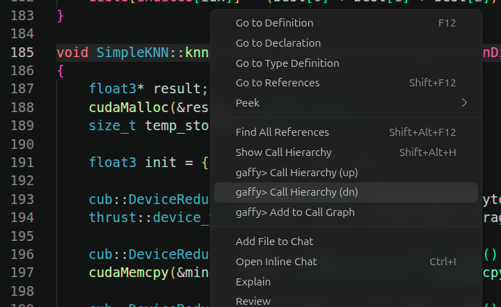
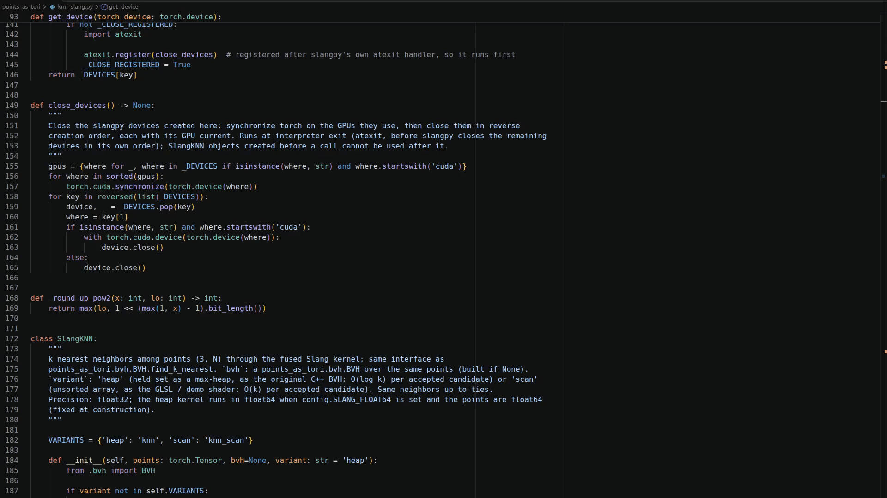

# gaffy
## Call Hierarchy graph.
One of the hammers in my bag to understand code tangles. Persistent data saved to `<vscode-root>/.baggy/`.

Extends vscode `Call Hierarchy` upstream with `downstream` calls in the form of `editable`, `persistent`, `exportable` as ASCII (UTF) graph style.

Supports `Python`, `TypeScript`, `JavaScript`, `Java`, `Rust`, `C`,`C++`, `CUDA`, `C#`, `Go`, `Kotlin`, `Swift`, `Dart`, relying on their language servers. Partial support for `Slang`.  Partial cross language support across `pybind11`, `nanobind`, `wasm-bindgen`. More info in [docs/development.md](docs/development.md).

Generates .json graphs saved as  `<vscode-root>/.baggy/gaffy/<symbol>_<commit>.gaffy`.

### Not published as vscode extension because...
MS appears to think that I am not human, ergo my accounts get locked when i try to publish. Perhaps I need an ai assisstant to pass the "are you human" tests.


## Install from Source

```bash
npm install
npm run package
npm run install:local   # ≡:  code --install-extension "gaffy-$(node -p "require('./package.json').version").vsix"

# reenter vscode or reload
`Ctrl+Shift+P` > Developer: Reload Window
```

### Usage: 1. Code tab > RMB over a symbol >  menu > 

```
gaffy> Call hierarchy (up)  # similar to VS Code Show Call Hierarchy: upstream callers
gaffy> Call hierarchy (dn)  # downstream calls
gaffy> Add to Call graph    # calls and callers in an existing call graph.
```


<p align="center">
   Call Hierarchy (up)" width="32.2%" align="middle">
  &nbsp;<b> -> generates editable vectors </b>&nbsp;
  
  &nbsp;<b> -> exports </b>&nbsp;
</p> 
<small>Example reference on https://github.com/Anttwo/MILo </small>

- Expandable modes: `>>` traverse individual calls, or `switch to -+ mode` a call depth step at once.
- Link types: `───` regular callers, `┈┈` class members,  `·─·─` cross language calls.

```
╭┄ scene ┄┄┄┄┄┄┄┄┄┄┄┄┄┄┄┄┄┄┄┄┄┄┄┄┄┄┄┄┄┄┄┄┄┄┄┄┄┄┄┄┄┄┄┄┄╮
┆  __init__.__init__()                                ┆
┆  └─> gaussian_model.GaussianModel.create_from_pcd() ·┐
┆  >> gaussian_model.GaussianModel.reinitial_pts() ─┐ ┆·
╰┄┄┄┄┄┄┄┄┄┄┄┄┄┄┄┄┄┄┄┄┄┄┄┄┄┄┄┄┄┄┄┄┄┄┄┄┄┄┄┄┄┄┄┄┄┄┄┄┄┄┄│┄╯│
                    ┌─·─·─·─·─·─·─·─·─·─·─·─·─·─·─·─┴─·┘
                    │╭┄ submodules/simple-knn ┄┄┄┄┄┄┄┄┄┄┄┄╮
                    └─> spatial.distCUDA2()               ┆
                     ┆  └─> simple_knn.knn()              ┆
                     ┆      ├─> simple_knn.coord2Morton() ┆
                     ┆      ├─> simple_knn.boxMinMax()    ┆
                     ┆      └─> simple_knn.boxMeanDist()  ┆
                     ┆          └─>>                      ┆
                     ╰┄┄┄┄┄┄┄┄┄┄┄┄┄┄┄┄┄┄┄┄┄┄┄┄┄┄┄┄┄┄┄┄┄┄┄┄╯
```




## General usage
Most interactions are intuitive albeit some may be arcanely named.

Saving a `.gaffy`, exporting to UTF, `.txt`, `.md`, or debug trace creates `<vscode root>/.baggy/`.

Default .gaffy vscode config declared in `package.json`, is accessble accessible thru the gaffy window `Options` menu. 


* Defaults: `Autosave []`, cross language `Bridges [✓]`, `Debug Layout []`, prefetch `Depth [3]`, `Exclude []` folders,  

`gaffy.depth`: 3, `gaffy.maxNodes`: 400, `gaffy.includeExternal`: false, `gaffy.includeStandardLibrary`: false, `gaffy.autoSave`: true, `gaffy.refreshOnSave`: 'touched', `gaffy.openDefinitions`: true, `gaffy.style`:  {}, `gaffy.exclude`: [],`gaffy.openCallHierarchy`: true,`gaffy.bridges`: true,`gaffy.saveViews`:`default`: false, `gaffy.debugLayout`: `default`: false,`gaffy.trace`: false


Layout

 or  Unsaved graphs prompt user decision on close. Graphs can be set to Autosave in vscode .gaffy settings which is accessible thru the Options menu. Other gaffy vscode settings are self explanatory.

There are several graph layout options


This setting can be changed thru the Options menu (top right), the vscode .gaffy settings accessible thru vscode or the options menu.


Development: `gaffy/` in VS Code, F5 (Extension Development Host); `npm run watch` rebuilds on change.

## Docs

- [docs/development.md](docs/development.md): tooling, release, publishing, project parts, security measures.
- [docs/heuristics.md](docs/heuristics.md): layout rules with code links, as a pipeline graph; [docs/heuristics.gaffy](docs/heuristics.gaffy): the same graph as a gaffy view.
- [docs/ordering.md](docs/ordering.md): functions that change what a view shows and where (triggers, interpreters, layout), drawing of one call, what a drag moves.


## Views from scripts

A script writes a view file with seeds by name and opens it; gaffy resolves each seed (document symbols, call hierarchy) and asks the language server within the view's depths. Seeds: `<path>#<qualified name>` or `<path>:<line>` (1-based, inside the definition), path relative to the folder holding `.baggy/` (the repository), else to the workspace folder; a seed not found is reported in a warning. `"save": true`: the file is saved after every change, whatever `gaffy.autoSave` says.

```python
import json, pathlib, subprocess

view = {"gaffy": 1, "name": "batch", "view": {
    "seeds": ["src/pkg/mod.py#Scoobie.do", "src/pkg/other.py#magoo", "src/pkg/other.py:120"],
    "arrange": "auto", "direction": "both", "depthUp": 2, "depthDown": 3, "save": True}}
p = pathlib.Path(".baggy/gaffy/batch.gaffy")
p.parent.mkdir(parents=True, exist_ok=True)
p.write_text(json.dumps(view))
subprocess.run(["code", str(p)])
```

`depthUp`: caller levels, `depthDown`: callee levels (`"all"`: every level); `"arrange": "grow"` instead starts one layer at a time. `"between": true`: only the functions on call paths from one seed to another are drawn (connectivity of the seeds; `depthUp`, `depthDown` set how far paths are searched; with both 0, the seeds and the calls among them). The resolved view replaces the names with gaffy keys and stores the graph.

## Building, progress, cache

- Progress: status line `⟳ language server: <phase> …` with growing dots (seed resolution `resolving seeds 3/34`, then layers, definitions, language-server requests, cached answers), the same phase in a banner over the graph; after 400 ms also a notification with cancel.
- Cache: each language-server answer (callers or callees of one definition), in `.baggy/gaffy/cache/calls.json` (`calls-external.json` for views with external code). Depth or direction changes, expansion and view opening ask the language server only for uncached answers.
- Invalidation: a saved, renamed or externally changed source file drops its definitions' cached outgoing calls and all cached incoming calls; files of an extension no cached definition has (logs, bytecode, build output): none. `gaffy: Clear Call Cache`: everything.
- No answer ≠ empty answer: a definition the language server does not resolve (analyzing after a reload, renamed, removed) keeps its stored calls, uncached, unexplored; retries after 2, 4, 8, 15, 30, 60 s (`language server not ready` in the status line), then a warning with the count.
- Timeout: 30 s without an answer counts as no answer (retried); one stalled request never holds the queue.
- Unfrozen view: explored (definition, direction) pairs take cached answers; stale pairs on screen asked again in the background, off screen kept and asked when a side opens onto them. Nothing changed since the last save: no request.
- **Refresh Language Server** (Options > File, `r`, `gaffy: Refresh Language Server`): every on-screen (definition, direction) pair asked again; cached answers of the others dropped (asked when a side or a call depth reaches them).

## Change tracking

- Source save: open views with a definition from that file updated (`gaffy.refreshOnSave`: `touched`, `all`, `off`), asking only the pairs made stale.
- File rename: keys, paths, URIs rewritten in open views, then updated alike.
- Definition identity across line moves: keys `<lang>:<path>#<qualified name>`.
- Views keep every definition the language server named; closed sides, lower call depths, hides only take them off screen.

## Files

```
.baggy/                        shared with giddy (.baggy/giddy/: reports, commits.md)
  gaffy/
    <symbol>_<commit>.gaffy    view: seeds, direction, depth, open sides, call depths, cut calls, collapsed, hidden, grouping,
                               folder include and exclude, tags, straightened calls, Options values, last graph, the
                               directions asked per definition, commit at last build (JSON)
    <symbol>_<commit>.md       text export, <pre> with links to path#Lline, seeds in bold; <commit> = short HEAD hash, or
    <symbol>_<commit>.txt      <YYYYMMDD-HHMM> outside git; later exports of the same symbol and commit: _2, _3, …
    cache/calls.json           cached language-server answers (calls-external.json: views with external code)
    trace/<view>.jsonl         change log (gaffy.trace)
    style.json                 style overrides (gaffy: Edit Style writes the defaults)
```

Placement: views created in VS Code under the workspace folder; views written by giddy or a script under their repository (seed paths, exports and the commit hash refer to the folder holding `.baggy/`). Style and call cache: per workspace folder. Views in a `.gaffy/views/` folder still open; new files go to `.baggy/gaffy/`.

## Layout debugging

Setting `gaffy.debugLayout` (Options > Arrange > Layout debug). Right click a function or box > **Why Here?**: the placement and settle decisions that put it where it is drawn, one line each: rule (as in [docs/heuristics.md](docs/heuristics.md)), function, the unit placed, outcome, values. Decisions past a threshold are flagged (⚑, wavy underline on the graph; thresholds `FLAGS` in [src/core/explain.ts](src/core/explain.ts)): an unmoved box or block sliding ≥ 12 rows, a moved function sliding ≥ 4 rows, a settle move ≥ 12 cells, an unmoved box pushed below a frame stretched by moves inside it. Options > Arrange > Layout debug turns it on; below it, each switchable rule on or off (h13 caller alignment, h15 block descent, h17 item column, h18 item row, h20 unmoved box descent, h21 moved function descent, h23 settle), the picture redrawn without it and nothing saved while one is off; Decision log: every decision in an editor.

Offline, in this repository (code lines from the rule anchors, [scripts/rules.ts](scripts/rules.ts)):

```bash
npm run explain -- <view.gaffy>                       # every decision, with file:line
npm run explain -- <view.gaffy> --unit <text> --flags # one unit's decisions, flagged only
npm run explain -- <view.gaffy> --off h20_unmoved_box_descent,h23_settle   # what moves without these rules
npm run explain -- <view.gaffy> --trace .baggy/gaffy/trace/<view>.jsonl    # replay a gaffy.trace: jumps and flags per change
```

## Freeze on open

A view built earlier (language-server data in it), saved, closed and opened again opens frozen: no language-server requests, settled moves not written; the file stays as saved. Not frozen: a new view, a view written by giddy or a script (no data yet), an unsaved view. The toolbar shows **Unfreeze** (with the build time and commit); clicking it is an edit of the view (`view.live`, the id of this opening, and the Options values), so Ctrl+Z freezes again and Ctrl+Y unfreezes. Every opening has a new id: the next opening is frozen again. Options > File > Frozen toggles the same state. Edits (moves, hides, collapses) work while frozen; sides without stored calls stay closed. A giddy view (`"pinPaths": true`) builds with Paths between seeds only, then the paths stay pinned and the option turns off.

## Style

Precedence: `.baggy/gaffy/style.json` over the `gaffy.style` setting over `DEFAULT_STYLE` ([src/core/style.ts](src/core/style.ts)); numbers clamped to the ranges of [schemas/style.schema.json](schemas/style.schema.json).

```json
{
  "view":   { "arrange": "grow", "traverse": "command" },
  "font":   { "family": "'JetBrains Mono', monospace", "size": 13, "lineHeight": 1.25 },
  "grid":   { "indent": 4, "laneGap": 2, "parentRule": "dfs" },
  "edges":  { "mode": "vector", "curve": "rounded", "lead": 3, "tension": 0.5, "arrow": true, "width": 1, "glyphs": "unicode", "cross": "│" },
  "labels": { "strip": [], "parens": true },
  "boxes":  { "enabled": true, "modules": false, "root": true, "fill": "hue", "alpha": 0.08, "line": "dashed" },
  "route":  { "bend": 3, "cross": 6, "border": 4, "adjacent": 2, "channel": 4 },
  "colors": { "selection": "#ff9e3b", "highlight": "#3794ff" }
}
```

- Options defaults. At view creation, stored in the view: `view.arrange` (`grow` one layer at a time, `auto` full), `view.traverse` (`command`: the editor command determines the side; `both`). Every render, unless the view has its own choice: `edges.mode` (`vector`, `glyph`), `edges.curve`, `grid.parentRule` (`dfs`, `nearest`, `joint`), `boxes.enabled`.
- `edges.lead`: straight lead-out and lead-in of the sigmoid (cells); `edges.tension`: reach of the S-curve control points (0 sharp, 1 wide).
- `route.adjacent`: cost of a vertical run in the column next to an unrelated vertical line; `route.cross`: cost of a crossing.

### Colors

`colors` key → CSS custom property `--g-<key>` (`applyColors`, [src/webview/main.ts](src/webview/main.ts)), read by [media/webview.css](media/webview.css). Values: CSS colors or VS Code theme variables (`var(--vscode-…)`).

| key | default | element |
|---|---|---|
| `fg` | editor foreground | function names |
| `bg` | editor background | canvas, box header background |
| `edge` | line-number foreground | call lines, arrowheads, glyphs |
| `highlight` | focus border | hovered calls, calls of the hovered function |
| `selection` | active link foreground | selected calls (click on an arrow), outline of selected functions |
| `selected` | selection background | background of selected functions |
| `seed` | link foreground | seed functions |
| `between` | `#c8553d` (brick red) | functions on call paths between two seeds, regular weight |
| `twisty` | link foreground | `>>` and `└─>>` markers |
| `frame` | widget border | namespace box lines |
| `namespace` | description foreground | namespace box headers |
| `external` | disabled foreground | definitions outside the workspace |

New UI color: a rule in `media/webview.css` reading `var(--g-<key>)`; the key with its default in `DEFAULT_STYLE.colors` and in the CSS `:root` block (used before the style arrives).

## Settings

| setting | default | effect |
|---|---|---|
| `gaffy.depth` | 3 | one layer at a time: levels prefetched in the background; full: the starting call depths |
| `gaffy.maxNodes` | 400 | definitions fetched per build |
| `gaffy.openCallHierarchy` | true | also open VS Code's Call Hierarchy, in the References view, when creating a view |
| `gaffy.saveViews` | false | Autosave Graphs: new views written to `.baggy/gaffy/`, saved after each change. Off: closing an unsaved view discards it (hot exit keeps it across window reloads) |
| `gaffy.trace` | false | view change log, undo and redo included, in `.baggy/gaffy/trace/<view>.jsonl`: event, target, grid cell, acting functions, changed fields, moved labels and boxes; trusted workspaces only. Reader: `node tools/gaffy-trace.mjs <file>` (this repository) |
| `gaffy.exclude` | none | globs of folders and files kept off screen (for example `"**/tests/**"`); Options > Folders includes them again per view |
| `gaffy.includeExternal` | false | new views: show external code (Options > Folders per view): installed packages (site-packages, node_modules), stubs, system headers, build output, wasm-pack glue |
| `gaffy.includeStandardLibrary` | false | new views, with external code: builtins and standard library (Python typeshed `stdlib`, `pythonX.Y`; Rust core, alloc, std; C++ standard headers; TypeScript `lib.*.d.ts`); off: installed packages only; drawn without the language server |
| `gaffy.autoSave` | true | save the view file after each graph change |
| `gaffy.refreshOnSave` | touched | update policy after a source save |
| `gaffy.openDefinitions` | true | Open Definitions: a view from the editor opens beside it; a click opens the definition next to the graph. Off: active column; a click only selects |

## Tests and preview

Commands: [docs/development.md](docs/development.md#scripts). Preview page parameters: `dist/preview.html?doc=sh|exp4|star|grow|two[&edges=vector&curve=sigmoid&fill=hue&boxes=off&parentRule=joint]`.

Preview: the webview bundle in a browser, mocked VS Code API, fixture views (`sh`, `exp4`, `star`, `grow`, `two`) over made-up packages; `GAFFY_PREVIEW_FILE=<view.gaffy>` previews any view.

## License

Apache License 2.0 ([LICENSE](LICENSE)). Copies and derived works keep the attribution in [NOTICE](NOTICE): name, copyright, repository. Third-party code: [THIRD_PARTY_NOTICES.md](THIRD_PARTY_NOTICES.md).

[^lsp]: LSP, Language Server Protocol: JSON-RPC protocol between editors and language servers; call hierarchy requests `textDocument/prepareCallHierarchy`, `callHierarchy/incomingCalls`, `callHierarchy/outgoingCalls` since version 3.16.
