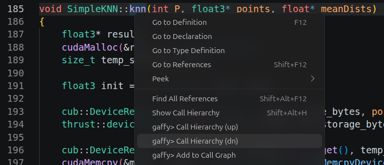
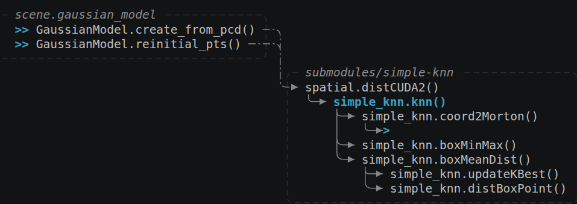
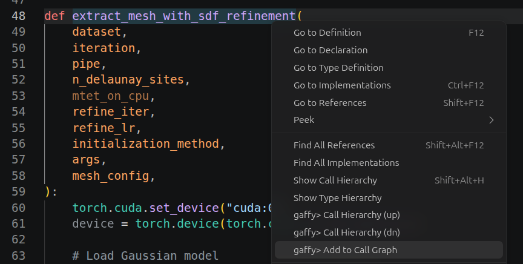
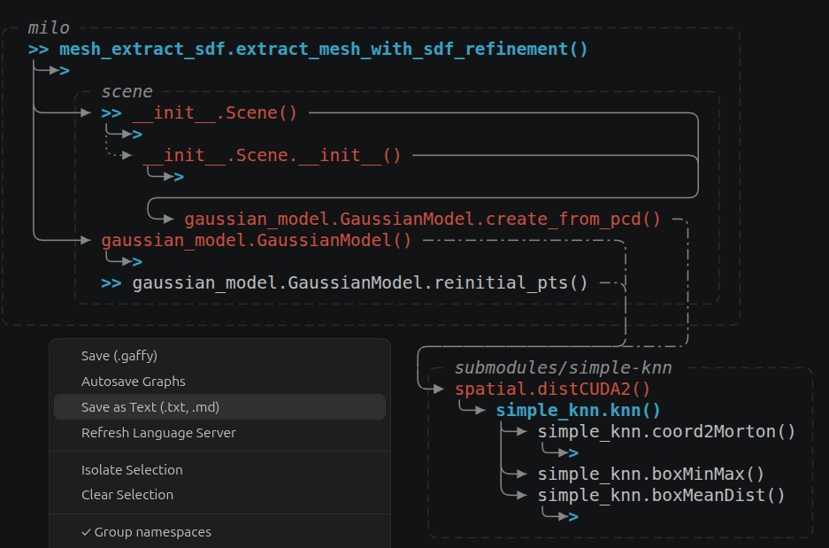
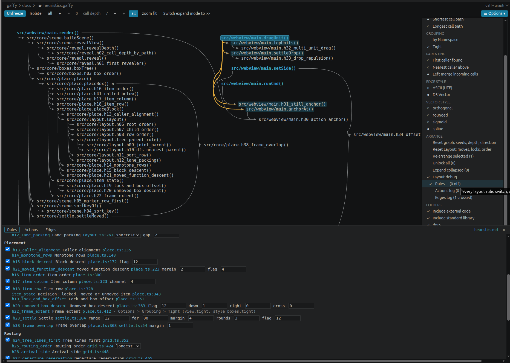

# gaffy
## Call Hierarchy graph.

Extends vscode `Call Hierarchy`, up, downstream and across languages. Generates persistent editable vector graphs extending D3 interactions, exportable as text in 'ASCII graph' style, UTF really.

Why D3. Because i like the look. 

Why ASCII style. 1. No other graph medium is as portable as text. 2. Line character grid enforcing makes for the most logical base rule for graphs containing text, leading to tighter graphing.

### Languages
Supports `Python`, `TypeScript`, `JavaScript`, `Java`, `Rust`, `C`,`C++`, `CUDA`, `C#`, `Go`, `Kotlin`, `Swift`, `Dart`, relying on installed language servers. Partial support for `Slang`.  Partial cross language support across `pybind11`, `nanobind`, `wasm-bindgen`. More info in [docs/development.md](./docs/development.md#L4). Language Providers: [src/core/langs.ts](./src/core/langs.ts#L95)

### Files
Generates JSON graph interpreted by gaffy viewer. Default unsaved, `gaffy.autoSave`. 

```
.baggy/                        shared with other tools in my bag of hammers. .gitignore .baggy/
  gaffy/
    <symbol>_<commit>.gaffy    JSON file if saved   # saved views are open frozen
    <symbol>_<commit>.md       saved on export markdown
    <symbol>_<commit>.txt      saved on exported text
    cache/calls.json           cached language-server answers
    trace/<view>.jsonl         gaffy.trace log
    style.json                 appearance: font, colors, labels, frames, call lines (Options set the rest per view)
```

### Not published as vscode extension because...
MS appears to think that I am not human, ergo my accounts get locked when i try to publish. Perhaps I need an ai assisstant to pass the "are you human" tests.


## Install from Source

```bash
npm install
npm run package         # typecheck, test, build .vsix
# npm run release       # alternative to `package`, increments version +0.0.1 in pakcage
npm run install:local   # install latest "gaffy-$(node -p 'require('./package.json').version').vsix"
# code --install-extension gaffy-<version>.vsix     #  install <version>

# reenter vscode or reload
`Ctrl+Shift+P` > Developer: Reload Window
```
## Use Interaction menus

VSCode context
- RMB over a function in a VSCode tab.
- RMB over a function in gaffy graph: inspect code functions, grouping, seeding, etc.

gaffy context
- RMB on the gaffy canvas. General fuynctions for the graph, Save, Export, clear. etc.
- RMB over a file in the VS Code explorer. Callers for all functions in a file.
- Top toolbar, Options. 

Examples of interactions with 1, 3 and 5, below.


## VS Code tab > RMB over a function >  menu > 
<small>Example parses thru https://github.com/Anttwo/MILo </small>

```
gaffy> Call Hierarchy (up)  # similar to VS Code Show Call Hierarchy: upstream callers
gaffy> Call Hierarchy (dn)  # downstream calls. Generates the same graph `seed` expanded once into callers.
    Expanding the graph a couple more times crosses from CUDA to python.

>> └─▶> folded caller | call. Click to expand.
 ────▶    expanded calls. Click on arrowheads collapse.
 ·─·─▶    call across languages.
 ····▶    Class members. Pylance patch to permit tracing a call path to an instanced class.
Select and delete a closes callers. Code can be filtered by folders.
```

  &nbsp;<b> VS Code function RMB context --> gaffy window with D3 Vectors </b>&nbsp;
<p align="left">
   Call Hierarchy (up)" width="44%" align="middle">
  
</p> 

```
gaffy> Add to Call Graph    # adds a new `seed` to the graph, which automatically expands calls linking functions, colored red.
```

<p align="left">
   Call Hierarchy (up)" width="47%" align="middle">
  
</p> 

## RMB over canvas e.g. Export as text

```
╭┄ milo ┄┄┄┄┄┄┄┄┄┄┄┄┄┄┄┄┄┄┄┄┄┄┄┄┄┄┄┄┄┄┄┄┄┄┄┄┄┄┄┄┄┄┄┄┄┄┄┄┄┄┄┄┄┄┄┄┄┄┄┄┄┄┄╮
┆  >> mesh_extract_sdf.extract_mesh_with_sdf_refinement()              ┆
┆  ├─>>                                                                ┆
┆  │   ╭┄ scene ┄┄┄┄┄┄┄┄┄┄┄┄┄┄┄┄┄┄┄┄┄┄┄┄┄┄┄┄┄┄┄┄┄┄┄┄┄┄┄┄┄┄┄┄┄┄┄┄┄┄┄┄┄╮ ┆
┆  ├────> >> __init__.Scene() ─────────────────────────────────────┐ ┆ ┆
┆  │   ┆  ├─>>                                                     │ ┆ ┆
┆  │   ┆  └┈> __init__.Scene.__init__() ───────────────────────────┤ ┆ ┆
┆  │   ┆      └─>>                                                 │ ┆ ┆
┆  │   ┆      ┌────────────────────────────────────────────────────┘ ┆ ┆
┆  │   ┆      └─> gaussian_model.GaussianModel.create_from_pcd() ·┐  ┆ ┆
┆  └────> gaussian_model.GaussianModel() ·─·─·─·─·─·─·─·─·─·┐     │  ┆ ┆
┆      ┆  └─>>                                              ·     ·  ┆ ┆
┆      ┆  >> gaussian_model.GaussianModel.reinitial_pts() ─·┤     │  ┆ ┆
┆      ╰┄┄┄┄┄┄┄┄┄┄┄┄┄┄┄┄┄┄┄┄┄┄┄┄┄┄┄┄┄┄┄┄┄┄┄┄┄┄┄┄┄┄┄┄┄┄┄┄┄┄┄┄·┄┄┄┄┄·┄┄╯ ┆
╰┄┄┄┄┄┄┄┄┄┄┄┄┄┄┄┄┄┄┄┄┄┄┄┄┄┄┄┄┄┄┄┄┄┄┄┄┄┄┄┄┄┄┄┄┄┄┄┄┄┄┄┄┄┄┄┄┄┄┄│┄┄┄┄┄│┄┄┄┄╯
                                        ┌·─·─·─·─·─·─·─·─·─·┴·─·─·┘
                                        │╭┄ submodules/simple-knn ┄┄┄┄┄┄┄┄┄┄┄┄╮
                                        └·> spatial.distCUDA2()               ┆
                                         ┆  └─> simple_knn.knn()              ┆
                                         ┆      ├─> simple_knn.coord2Morton() ┆
                                         ┆      │   └─>>                      ┆
                                         ┆      ├─> simple_knn.boxMinMax()    ┆
                                         ┆      └─> simple_knn.boxMeanDist()  ┆
                                         ┆          └─>>                      ┆
                                         ╰┄┄┄┄┄┄┄┄┄┄┄┄┄┄┄┄┄┄┄┄┄┄┄┄┄┄┄┄┄┄┄┄┄┄┄┄╯
```

Other interactions should be mostly intuitive: function grouping, edge styles etc. 


## Layout debug: from Options menu

Open ended graphs are always tangled, instead of using spring models I relied in heuristics, But those also tangle.
To manage that I added a debug mode, which allows individual heuristic rules to be turned off.
The real solution would be a bit smarter optimization but thats for another day.

- **Rules**: layout rule with switch, choice and parameters, saved with the graph. Includes links to [docs/heuristics.md](./docs/heuristics.md) and  to code. Terms: [docs/terms.md](./docs/terms.md).
- **Actions**: objects moved, results and rules.
- **Calls**: drawing logic. Branch, trunk, path search, search order, crossings, cost.

<p align="left">
   Call Hierarchy (up)" width="100%" align="middle">
</p> 

### Layout debug: from script.

```bash
npm run explain -- <view.gaffy>                        # every decision, with file:line
npm run explain -- <view.gaffy> --unit <text> --flags  # one unit's decisions, flagged only
npm run explain -- <view.gaffy> --off h20_unmoved_box_descent,h23_settle   # what moves without these rules
npm run explain -- <view.gaffy> --trace .baggy/gaffy/trace/<view>.jsonl    # replay a gaffy.trace
npm run metrics -- <view.gaffy> '{"alt":{"h25_routing_order":"longest"}}'  # crossings, bends, time per rule choice
```


## Scripting call graphs

```python
import json, pathlib, subprocess

# Seed syntax
# path/to/file.ext#Class.method  # must be a valid code symbol
# path/to/file.ext#function
# path/to/file.ext:line_number

view = {"gaffy": 1, "name": "batch", "view": {
    "seeds": ["src/pkg/mod.py#Scoobie.do"], # one or more valid seeds
    "arrange": "auto", # | grow  # expansion mode
    "direction": "both",
    "depthUp": 2,   # layers of callers
    "depthDown": 3, # layers of called 
    "save": True}}
p = pathlib.Path(".baggy/gaffy/batch.gaffy")
p.parent.mkdir(parents=True, exist_ok=True)
p.write_text(json.dumps(view))
subprocess.run(["code", str(p)])
```


## Docs

- [docs/development.md](./docs/development.md): tooling, release, publishing, project parts, security measures.
- [docs/heuristics.md](./docs/heuristics.md): layout rules with code links, as pipeline graph; [docs/heuristics.gaffy](./docs/heuristics.gaffy).
- [docs/ordering.md](./docs/ordering.md): view order functions: triggers, interpreters, layout/
- [docs/terms.md](./docs/terms.md): glossary to ensure any gobledigook is clarifiable.
- [docs/examples.md](./docs/examples.md): visual examples of heuristics.
- [refs.bib](./refs.bib): bibliography built during the search for graph algorithms. Includes nonstandard fields `project`, `preprint`, `code`. Which I find are useful references.


